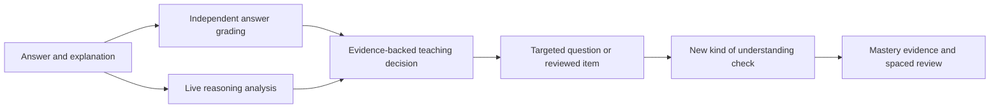

# Redpen

**An adaptive physics tutor that responds to how a learner reasons, not only which option they select.** Redpen identifies a likely misconception, chooses a suitable next teaching task, checks understanding in a different way, and records the evidence behind its learning estimates.

## Overview

Redpen is the PS-02 submission, **Adaptive exam-prep tutor with a learner model**, for The Product Space AI Hackathon. It focuses on Class 10 physics and adapts to the evidence in each learner’s answers and explanations.

### Live demo

**[Open Redpen →](https://redpen-three.vercel.app/)**

## Why Redpen

Most quiz flows grade a final answer and move on. Redpen also asks for reasoning. A learner who selects the right option for the wrong reason may still need help; a wrong answer caused by a calculation slip should receive a different response from a conceptual misunderstanding.

When the tutor detects a supported misconception, it chooses a targeted follow-up. The task can ask the learner to identify a principle, explain an error, apply an idea in a changed situation, or solve independently. Two correct responses with coherent live reasoning across different generated task types are needed before Redpen records improvement as observed. Later, spaced review checks whether that understanding lasts.



## Try it locally

Requirements: Node.js 22 or newer, npm, and a Groq API key with access to `openai/gpt-oss-20b`.

From this folder:

```powershell
npm ci
npm run setup:local
```

Open `.env.local` and set `LLM_API_KEY` to your Groq key. The setup command creates `.env.local` from `.env.example` if it does not exist, generates local session and teacher secrets if needed, and does not print credentials. Keep this file private; it is ignored by Git.

Start the app:

```powershell
npm run dev
```

Open the local address Next.js prints, then select **Start diagnostic** or **Go straight to practice**. Explain each answer in the reasoning box. The diagnostic starts with eight reviewed questions; targeted follow-ups can be inserted when the evidence calls for them. Progress is saved for the browser’s signed guest identity. **Reset my progress** erases that learner’s evidence only.

To use the teacher view locally, use the `TEACHER_ACCESS_CODE` in your private `.env.local`. The learner model and concept graph are available from the top navigation.

## Configuration

The defaults in `.env.example` point to Groq. For a local run, `npm run setup:local` generates session secrets; set `LLM_API_KEY` yourself.

| Variable | Purpose |
|---|---|
| `LLM_API_KEY` | Server-side Groq key. Required for live reasoning and question planning. |
| `LLM_BASE_URL` | Defaults to `https://api.groq.com/openai/v1`. |
| `LLM_MODEL` | Defaults to `openai/gpt-oss-20b`. |
| `SESSION_SECRET` | Stable signing secret, at least 32 characters. Do not rotate during normal deployments. |
| `TEACHER_ACCESS_CODE` | Private teacher unlock code, at least 12 characters. |
| `REDPEN_COHORT_ID` | Cohort assigned to new learners and teacher access; defaults to `physics`. |
| `REDPEN_STORE` | `auto` locally; use `redis` on Vercel. |
| `REDPEN_REDIS_KEY` | Redis key prefix. Use a distinct value for production and preview. |
| `UPSTASH_REDIS_REST_URL`, `UPSTASH_REDIS_REST_TOKEN` | Standard Upstash REST credentials. Vercel aliases are also supported. |
| `REDIS_KV_REST_API_URL`, `REDIS_KV_REST_API_TOKEN` | Names supplied by the Vercel Redis integration. The regular token must be write-capable. |

Product requests always use the live model. `MOCK_LLM=1` does not enable a product mock mode. Fixtures are available only to explicit automated test requests. API failure is surfaced to the learner and does not fabricate an analysis or generated question.

## Deploy on Vercel

1. Import this app as its own Vercel project. Set the project Root Directory to `ps-02-exam-tutor` if the Git repository contains the parent folder; if the repository itself is this app, use `.`.
2. Add the Vercel Redis integration and connect its database to this project.
3. Add Production environment variables:

   ```env
   REDPEN_STORE=redis
   REDPEN_REDIS_KEY=redpen:production:v1
   REDPEN_COHORT_ID=physics
   LLM_BASE_URL=https://api.groq.com/openai/v1
   LLM_MODEL=openai/gpt-oss-20b
   MOCK_LLM=0
   CACHE_LLM=0
   ```

4. Add `LLM_API_KEY`, a stable `SESSION_SECRET` (32+ characters), and a private `TEACHER_ACCESS_CODE` (12+ characters). Vercel Redis credentials are read directly from `REDIS_KV_REST_API_URL` and `REDIS_KV_REST_API_TOKEN`; the standard Upstash and `KV_REST_API_*` names are accepted too. Do not use the read-only token or prefix secrets with `NEXT_PUBLIC_`.
5. Redeploy after connecting storage and saving environment variables. Production deliberately refuses to start with an ephemeral file store when Redis is unavailable.
6. Verify `/tutor`, refresh after submitting an answer, then check `/tutor/graph`, `/tutor/teacher`, and `/tutor/debug`. See [Deployment guide](DEPLOYMENT.md) for the full deployment and verification steps.

Vercel and Groq are external services: this repository does not provision their accounts or credentials. A successful local live check does not establish that the hosted deployment is configured.

## Screens

| Route | What it shows |
|---|---|
| `/tutor` | Diagnostic and adaptive practice, answer feedback, reasoning analysis, next teaching task, review queue, and concept evidence. |
| `/tutor/graph` | Physics concepts and prerequisites with the current learner’s evidence. |
| `/tutor/teacher` | Access-code protected cohort summary, actual learner evidence, and concept-level class patterns. |
| `/tutor/debug` | The current learner’s versioned evidence trail and model records. |

Teacher analytics use stored attempts from enrolled guest learners in the configured cohort. An empty cohort remains empty. No synthetic class is created during normal product use.

## How question generation stays grounded

Groq analyses the learner’s explanation against a closed, reviewed misconception taxonomy. A named prompt and server validator constrain that analysis. Supporting quotes must match the learner’s text. The server selects from seven supported question families across six physics concept areas, and the learner model chooses the thinking task. Groq proposes a plan; a deterministic physics renderer creates the question and independently computes its correct answer. Invalid, duplicate, or unsupported plans are rejected. Unsupported concepts and advanced items use the reviewed question bank and are labelled accordingly.

The learner model uses a bounded Rasch-style update with confidence based on the amount of evidence. These values are learning estimates, not diagnoses or proof of permanent mastery. Review scheduling uses five Leitner intervals: 1, 3, 7, 21, and 60 days.

## Developer commands

Run commands from this app directory:

```powershell
npm run typecheck
npm test
npm run validate:content
npm run build
npm run smoke
```

`npm run check:live` and `npm run check:live-learning` make genuine Groq requests using the local key. They use isolated, in-memory learner state. Do not run `npm run seed` to clear one learner’s progress: it resets the local store. See [Testing and validation](docs/TESTING-VALIDATION.md) for what each check covers and the latest recorded results.

## Project documents

- [Software Requirements Specification](docs/SRS.md)
- [System Architecture](docs/SYSTEM-ARCHITECTURE.md)
- [Testing and Validation](docs/TESTING-VALIDATION.md)
- [Deployment guide](DEPLOYMENT.md)
- [Demo guide](DEMO.md)
- [Hackathon submission overview](SUBMISSION.md)
- [Implementation phase log](PHASE-LOG.md) and [changelog](CHANGELOG.md)
- [Approved real-solution plan](../docs/REDPEN-REAL-SOLUTION-PLAN.md)

## Scope and honest limitations

Redpen is a hackathon learning product, not a production school information system. It has signed anonymous browser sessions and a protected teacher code, not student accounts, password recovery, or cross-device identity. Its generated content is limited to reviewed patterns; it is not a general-purpose physics question author. The mastery and confidence estimates have not been validated against a large educational study. Provider latency, quotas, Redis availability, and hosting configuration affect the live experience. The active scope and evidence are described in the companion documents rather than inferred from the earlier prototype plans.
