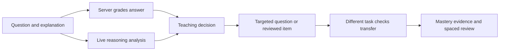

# Software Requirements Specification

## Redpen — Adaptive Exam-Prep Tutor

| Field | Value |
|---|---|
| Document | Software Requirements Specification (SRS) |
| Product | Redpen, Product Space PS-02 |
| Version | 1.0 |
| Date | 31 October 2026 |
| Status | Describes the implemented hackathon submission |

## 1. Purpose

This document defines Redpen’s users, scope, functional and quality requirements, constraints, assumptions, and acceptance conditions. It is intended for hackathon judges, developers, teachers, and reviewers. See [System Architecture](SYSTEM-ARCHITECTURE.md) for implementation structure and [Testing & Validation](TESTING-VALIDATION.md) for observed evidence.

## 2. Product overview

Redpen is a browser-based Class 10 physics tutor. It builds a learner model from submitted answers and written reasoning. Live Groq model calls classify reasoning against known misconceptions and propose constrained question plans. Server-side rules choose a teaching task; reviewed renderers and independent solvers create and grade supported questions. The tutor schedules concept reviews and offers a protected teacher view over stored cohort evidence.

## 3. Goals and success criteria

- Track evidence by learner and concept across requests.
- Use reasoning as evidence; distinguish supported misconception, calculation slip, sound reasoning, and uncertainty.
- Match the teaching response to evidence and verify understanding using a different task kind.
- Compute generated answer keys independently from the model’s proposed plan.
- Persist learner progress and present cohort evidence to an authorized teacher.
- Disclose uncertainty, question provenance, and provider failures instead of fabricating results.

## 4. Users and environment

### Learner

Starts a diagnostic or practice session without email registration. Redpen assigns a signed anonymous browser identity and associates progress with it. Learners submit an offered answer choice with a written explanation, receive feedback, continue to the next question, inspect concept evidence, and reset their own progress.

### Teacher

Enters a configured access code to establish a short-lived teacher session for one configured cohort. The teacher sees actual stored cohort attempts and concept summaries. The shared code is not an institutional account or role-management system.

### Runtime

Next.js runs on a Node-compatible host. Local development uses a durable JSON file; Vercel production requires persistent Redis REST storage. Live reasoning and question planning require a Groq-compatible chat-completions endpoint and server-side API key.

## 5. Scope

### In scope

- Class 10 physics concept graph, prerequisite relationships, misconception taxonomy, reviewed question bank, and eight-question diagnostic.
- Learner-specific answer, reasoning, mastery, learning, misconception, session, and spaced-review evidence.
- Live analysis for correct and incorrect answers against relevant known misconceptions.
- Teaching responses for misconception correction, clarification, calculation slips, verification, and advancement.
- Four generated task kinds: identify a principle, explain an error, apply an idea in a changed situation, and calculate independently.
- Seven constrained question families across six concept areas: Ohm’s law, series current and voltage, reflection, lens power, electrical energy, and myopia.
- Independent deterministic answer generation, duplicate rejection, and provenance disclosure.
- Concept evidence, protected teacher cohort view, file and Redis persistence, and deployment documentation.

### Out of scope

- Full school information system, student roster import, email/password accounts, password recovery, or cross-device recovery.
- Unrestricted natural-language physics generation or arbitrary model-supplied answer keys.
- Guarantee of complete current board coverage, exam prediction, or mastery certification.
- Webcam, gesture, eye-tracking, keystroke, biometric, or learning-disability diagnosis.
- High-stakes placement decisions, institutional single sign-on, or large-scale production classroom guarantees.

## 6. Functional requirements

| ID | Requirement | Acceptance condition |
|---|---|---|
| FR-01 | Start diagnostic or practice | Learner can start either mode; refresh resumes the signed learner’s current session. |
| FR-02 | Collect answer and reasoning | Submission requires a listed choice and non-empty explanation within server limits. |
| FR-03 | Grade on server | Correctness comes from the stored question key, not a client key or LLM judgment. |
| FR-04 | Analyze reasoning | Live analysis checks the explanation against relevant misconception candidates, including on correct choices. |
| FR-05 | Validate classification | Tags must be known; confidence valid; quoted evidence must match learner text. Weak or invalid evidence stays uncertain/unavailable. |
| FR-06 | Select teaching action | Policy chooses a response for misconception, slip, uncertainty, or sound reasoning and gives a rationale. |
| FR-07 | Vary task type | Supported follow-ups use four task kinds and avoid repeating recent kinds for the concept. |
| FR-08 | Verify improvement | Two different generated task kinds must have correct answers and coherent live reasoning before improvement is observed. |
| FR-09 | Constrain generated plans | Named prompt and schema constrain model output to supported family, variant, and parameters. |
| FR-10 | Independently compute keys | Deterministic renderer computes question, choices, key, and explanation. Model does not provide the answer key. |
| FR-11 | Reject invalid plans | Malformed, unsupported, duplicate, or solver-invalid plans are rejected; saved response remains available to retry. |
| FR-12 | Update learner model | Accepted answers append attempt evidence and update mastery, confidence, and review for covered concepts. |
| FR-13 | Schedule review | Each answered concept receives a Leitner review date; wrong or misconception evidence shortens the interval. |
| FR-14 | Isolate learners | Server derives identity from a signed HTTP-only cookie; learner reads, writes, and reset are identity-scoped. |
| FR-15 | Protect teacher view | Teacher records require a signed teacher session for the configured cohort; unlock attempts are bounded. |
| FR-16 | Aggregate actual evidence | Teacher summary uses registered learners in the cohort; missing evidence remains unknown. |
| FR-17 | Disclose provenance and failure | UI labels generated versus reviewed-bank questions; model failures do not become fixture analyses. |
| FR-18 | Persist answer transaction | Related session, attempt, mastery, and review updates commit transactionally to local file or Redis. |
| FR-19 | Reset own evidence | Learner reset clears only that learner’s scoped evidence. |
| FR-20 | Keep credentials server-side | Browser never receives Groq key or Redis REST token. |

## 7. Non-functional requirements

| ID | Requirement |
|---|---|
| NFR-01 | Generated keys come from deterministic family solvers and validated parameter ranges. |
| NFR-02 | Learner data is identity-scoped; teacher access is cohort-scoped. |
| NFR-03 | Retried answer tokens do not add duplicate evidence. |
| NFR-04 | Local writes persist before acknowledgement; Vercel cannot silently use ephemeral files. |
| NFR-05 | Mastery/confidence remain estimates; missing evidence is never shown as measured mastery. |
| NFR-06 | Generation failure retains the submitted answer and exposes retry. |
| NFR-07 | Domain policy, solvers, and aggregation are separated from React and network calls. |
| NFR-08 | UI provides clear question, choice, reasoning, feedback, task, provenance, and error text. |
| NFR-09 | Model endpoint and model ID are configurable via server environment variables. |
| NFR-10 | Answer text, provider output, learner request rate, and teacher unlock attempts are bounded. |

These requirements describe the intended implementation safeguards, not an independent security certification or measured educational efficacy.

## 8. Data and privacy requirements

Root storage contains learner profile/cohort registration and limits. Per-learner namespaces contain session, item, attempt, mastery, misconception, learning, and review facts. Versions and source IDs maintain evidence history. Teacher summaries first filter profiles by cohort, then read each learner’s scoped records.

Learner explanations are student data. The current question, answer, reasoning, and relevant taxonomy candidates are sent to the configured model provider for live analysis. The app also persists submitted reasoning as learner evidence. Avoid entering personal identifiers into the reasoning field.

## 9. External interfaces

- **Groq Chat Completions:** authenticated server-to-server JSON; structured response; named prompts in `prompts/`.
- **Redis REST:** authenticated server-to-server operations and atomic compare-and-set for snapshot transactions. Vercel names `REDIS_KV_REST_API_URL` and `REDIS_KV_REST_API_TOKEN` are supported.
- **Browser:** same-origin Next.js pages/server actions with signed cookies; no public generic LLM proxy.

## 10. Constraints and assumptions

- Guest sessions last up to 30 days in one browser; clearing cookies loses access to that identity.
- Session signing and teacher secrets must be configured server-side and retained across normal deployments.
- Vercel requires connected persistent Redis and redeployment after environment changes.
- Groq model availability, response formats, latency, quotas, and terms are external dependencies.
- The reviewed bank covers a bounded hackathon syllabus, includes legacy extension material, and does not promise complete current-board coverage.
- Mastery is a heuristic/Rasch-style estimate whose thresholds require future validation against learning outcomes.

## 11. Acceptance summary

The hackathon submission is acceptable when the diagnostic/session flow runs; grading, identity scoping, teaching feedback, task-diverse generated verification and review scheduling work; teacher access is protected and reports stored cohort evidence; and live failures remain visible. See [Testing & Validation](TESTING-VALIDATION.md) for evidence and limits.
