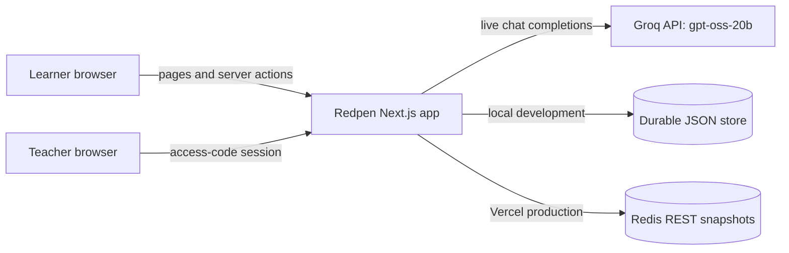
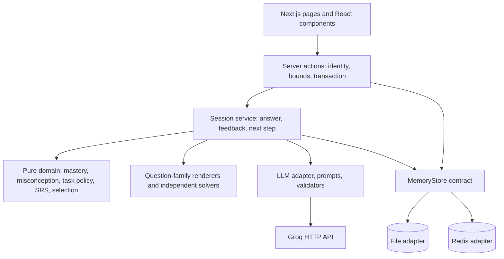
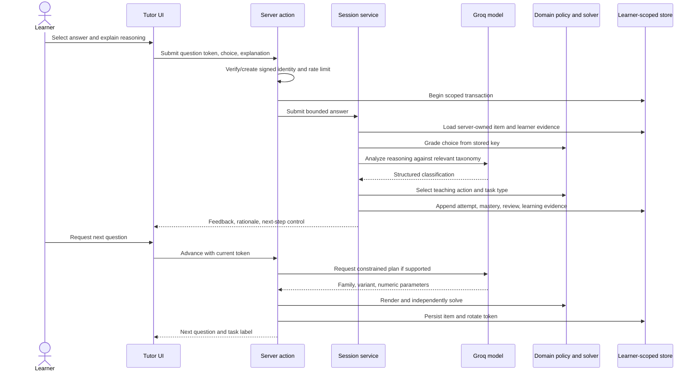

# Redpen System Architecture

| Field | Value |
|---|---|
| Product | Redpen — Adaptive Exam-Prep Tutor |
| Document | System Architecture |
| Version | 1.0 |
| Date | 31 October 2026 |
| Status | Reflects the implemented PS-02 application |

## 1. Architectural intent

Redpen separates model interpretation from authoritative educational state changes. The model classifies reasoning and suggests a constrained question plan. Server policy chooses the next task; deterministic physics renderers compute the item and key; server code grades and records evidence. Model-generated text cannot directly set correctness or mastery.

## 2. System context

Groq key, session signing secret, teacher code, and Redis credentials are server environment variables. The browser never receives them. The generic public LLM proxy has been removed.

## 3. Runtime layers

### Presentation

`src/app/` provides tutor, concept graph, teacher, and learner model routes. `src/components/TutorSession.tsx` presents the question, reasoning input, feedback, selected task, source, and recovery messages. Components do not own prompts or authoritative answer keys.

### Application orchestration

`src/app/tutor/actions.ts` reads or creates the signed learner identity, bounds request rate, enters a store transaction, then calls `session-service.ts`. The session service coordinates grading, reasoning analysis, teaching policy, learner state updates, review scheduling, and advancement.

### Domain logic

Pure logic under `src/lib/` covers Rasch-style mastery updates, taxonomy and validation, teaching policy, task selection and rendering, solvers, diagnostic selection, spaced review, signed identity tokens, and cohort aggregation. These functions avoid React and network I/O.

### Model and prompt boundary

Product calls pass through `src/platform/llm.ts` and named prompts under `prompts/`. Reasoning analysis returns a closed taxonomy result; quotes are checked against learner text. Generation returns a family plan. Schema, family, parameters, item identity, duplicates, and solver output are validated before storing. Fixtures are explicit test-only behavior.

## 4. Learning request sequence

Generation failure does not undo the saved answer. It exposes retry. Unsupported concepts/levels use the reviewed bank with provenance shown.

## 5. Adaptive task policy and generation

The four task kinds are **identify-principle**, **explain-error**, **apply**, and **calculate**. Teaching action and recent task history choose the next kind; the policy avoids the last two task types for that concept. For supported misconceptions, a learner can move from explaining an error to applying the principle in a changed situation. Improvement from generated verification requires two correct answers and sound live reasoning across distinct task kinds. Practice then shifts to another concept while keeping the improved concept in spaced review.

Generation is a bounded family system rather than unrestricted question writing. Seven numerical families cover six concept areas. Deterministic code owns wording, choices, key, and explanation. Range checks and content identity reject invalid or repeated items.

## 6. Learner model and review

Each concept begins with mastery prior 0.5 and confidence 0. A bounded logistic update changes the latent logit based on correctness and difficulty; diagnostic evidence uses a stronger rate. Supported misconception evidence can add a penalty and tag strength. Confidence grows with observations and is capped at 1. UI labels values as estimates and leaves unobserved concepts unknown.

Leitner review intervals are 1, 3, 7, 21, and 60 days. Correct evidence may promote the box when mastery exceeds the configured threshold; wrong answers lower it; a misconception resets to the first box with remediation.

## 7. Identity, authorization, and data boundaries

- Learners use random UUID identities in signed HTTP-only, SameSite=Lax cookies lasting up to 30 days. Cookies are Secure in production. Server checks signature, expiry, role, and cohort.
- Learner facts are scoped to the signed identity. Personal reset only clears the current learner.
- Teacher unlock uses a configured code compared in constant time. Teacher cookie lasts up to eight hours; attempts are bounded and cohort reads are filtered.
- Anonymous sessions resume in the same browser; they do not provide full account authentication or recovery.
- Learner explanations are sent to the configured model provider for live analysis and are persisted in learner attempts. Treat them as student data.

## 8. Persistence and deployment

### Local development

`REDPEN_STORE=auto` uses a durable JSON file when Redis is absent. File transactions commit a complete snapshot before acknowledging. Use one local Node process with this backend.

### Vercel

`REDPEN_STORE=redis` selects the Redis REST adapter. It accepts `UPSTASH_REDIS_REST_URL` / `UPSTASH_REDIS_REST_TOKEN`, `KV_REST_API_URL` / `KV_REST_API_TOKEN`, and Vercel Redis names `REDIS_KV_REST_API_URL` / `REDIS_KV_REST_API_TOKEN`. A write-capable token is required. A per-learner Redis key holds learning facts; a root key holds registrations and limits. Versioned snapshots use atomic compare-and-set with retry for concurrent writes. The app refuses ephemeral file fallback on Vercel.

The whole-snapshot adapter is sized for a hackathon cohort, not unlimited production scale. Redis provisioning and Vercel environment setup are operational steps; see [Deployment guide](../DEPLOYMENT.md).

## 9. Conceptual data model

| Record | Scope/key | Purpose |
|---|---|---|
| Learner profile | Root / learner UUID | Cohort membership and teacher index. |
| Tutor session | Learner / active session | Current item, token, diagnostic position, purpose, feedback. |
| Attempt | Learner / attempt ID | Item, answer, reasoning, correctness, analysis, decision, provenance. |
| Mastery | Learner / concept ID | Logit, mastery, confidence, attempts, misconception strengths. |
| Learning evidence | Learner / concept ID | Verification status, tag, successful distinct tasks. |
| Review | Learner / concept ID | Leitner box, due time, remediation flag. |
| Generated item | Learner / item ID | Rendered question, parameters, family and task provenance. |
| Limits | Root / window or request key | Learner request and teacher unlock bounds. |

Store versions and source IDs preserve evidence history. Teacher aggregation filters profiles by cohort and reads learner scopes; missing evidence remains unknown.

## 10. Failure behavior

| Failure | Behavior |
|---|---|
| Missing model key | Live call reports configuration error; product fixture is not substituted. |
| Timeout, throttling, provider rejection | Submitted answer stays saved; UI reports failure and permits retry. |
| Invalid classification | Response is rejected; unsupported misconception is not assigned. |
| Invalid or repeated question plan | Schema/solver/identity validation rejects the item before persistence. |
| Redis absent on Vercel | Store access fails explicitly rather than using ephemeral files. |
| Concurrent Redis updates | Compare-and-set detects conflict and retries from latest snapshot. |
| Unsupported generated family | Reviewed-bank item is selected and labelled. |

## 11. Architectural decisions and limits

Server code owns grading, question keys, task policy, identity scope, and persistent evidence. The model interprets reasoning and proposes constrained inputs only. There is no synthetic class in normal product use. Mastery thresholds have not been validated by a controlled educational study; generated coverage is limited; institutional authentication, schema migration, penetration testing, large-scale load tests, and hosted Vercel/Redis verification remain outside local build evidence.
